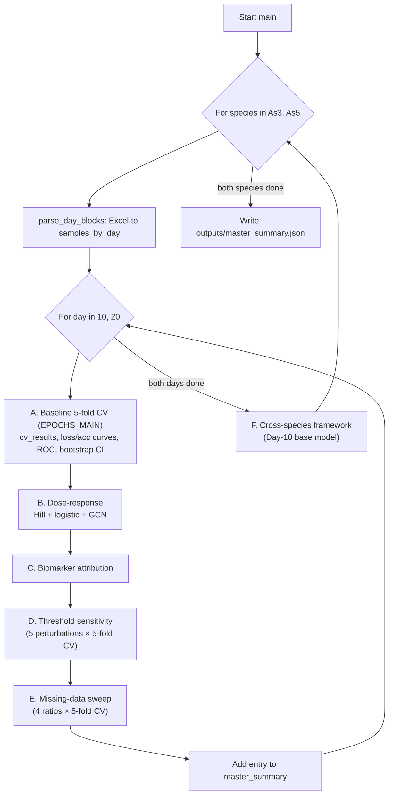

# Arsenic Toxicity Prediction with Graph Convolutional Networks (As³⁺ / As⁵⁺)

A modular, end-to-end PyTorch Geometric pipeline that predicts whether a fish blood sample comes from a **toxic (abnormal) arsenic exposure** using a small **Graph Convolutional Network (GCN)** trained on 11 haematological and biochemical biomarkers. The pipeline covers two arsenic species, trivalent arsenite (**As³⁺**) and pentavalent arsenate (**As⁵⁺**), at two exposure durations (**Day 10** and **Day 20**), and adds six supplementary analyses: dose–response curve fitting, biomarker attribution, threshold sensitivity, cross-species generalisation, bootstrap confidence intervals, and missing-data robustness.

The code is a refactor of two original Google Colab notebooks (`As³⁺ Toxicity_Prediction…ipynb` and `As⁵⁺ Toxicity_Prediction…ipynb`) into plain Python modules that run locally or on a server with a single command.

---

## Table of contents

1. [Scientific background](#1-scientific-background)
2. [Repository layout](#2-repository-layout)
3. [Installation](#3-installation)
4. [Quick start](#4-quick-start)
5. [Input data format](#5-input-data-format)
6. [Labelling scheme](#6-labelling-scheme)
7. [Graph construction](#7-graph-construction)
8. [Model architecture](#8-model-architecture)
9. [Training procedure](#9-training-procedure)
10. [Evaluation and bootstrap confidence intervals](#10-evaluation-and-bootstrap-confidence-intervals)
11. [Supplementary experiments](#11-supplementary-experiments)
12. [Pipeline execution flow (`main.py`)](#12-pipeline-execution-flow-mainpy)
13. [Output files reference](#13-output-files-reference)
14. [Results from the included run](#14-results-from-the-included-run)
15. [Configuration reference](#15-configuration-reference)
16. [Module and function API reference](#16-module-and-function-api-reference)
17. [Reproducibility notes](#17-reproducibility-notes)
18. [Known limitations and caveats](#18-known-limitations-and-caveats)
19. [Extending the pipeline](#19-extending-the-pipeline)
20. [Troubleshooting](#20-troubleshooting)

---

## 1. Scientific background

Arsenic is a widespread aquatic contaminant whose toxicity depends strongly on its oxidation state. Arsenite (As³⁺) is generally considered more toxic than arsenate (As⁵⁺). In fish, sub-lethal arsenic exposure perturbs blood chemistry: red-cell indices drop, liver enzymes rise, and glucose, protein, and ion balance shift.

The study organism referenced in the code is the **olive flounder** (*Paralichthys olivaceus*). Fish were exposed to graded concentrations of each arsenic species, and blood was sampled after 10 and 20 days. Eleven biomarkers were measured per fish:

| Group | Biomarkers | Typical physiological meaning |
|---|---|---|
| Haematological | `Hb` (haemoglobin), `Hct` (haematocrit), `RBC count` | Oxygen-carrying capacity, anaemia |
| Ions / metabolites | `Calcium`, `Magnesium`, `Glucose` | Osmoregulation, stress response (hyperglycaemia) |
| Lipid / protein | `Cholesterol`, `Total protein` | Hepatic synthesis, nutritional status |
| Liver enzymes | `AST`, `ALT`, `ALP` | Hepatocellular damage |

The modelling goal is binary classification: **0 = normal**, **1 = abnormal (toxic exposure)**.

---

## 2. Repository layout

```
Arsenic_Toxicity_Prediction/
├── core.py                 # Constants, Excel parsing, labelling, graph builder, GCN model, GraphMixUp
├── train_eval.py           # Stratified 5-fold CV training/evaluation + bootstrap 95% CI
├── experiments.py          # Supplementary experiments 1–4 (dose-response, attribution, threshold, cross-species)
├── main.py                 # Orchestrates the whole pipeline (also runs experiment 6: missing data)
├── fig_missing_data_v2.py  # Stand-alone publication figure for the missing-data experiment
├── README.md
├── data/
│   ├── 3가 비소.xlsx        # As³⁺ (trivalent arsenic) raw data
│   └── 5가 비소.xlsx        # As⁵⁺ (pentavalent arsenic) raw data
├── outputs/                # All generated results (see §13)
│   ├── master_summary.json
│   ├── As3/
│   │   ├── Day-10/  …
│   │   ├── Day-20/  …
│   │   └── cross_species/
│   └── As5/
│       ├── Day-10/  …
│       ├── Day-20/  …
│       └── cross_species/
├── __pycache__/            # Python bytecode (safe to delete)
└── .qodo/                  # IDE/agent tooling folder (not used by the pipeline)
```

> **Filename note.** The data files are named in Korean: `3가 비소.xlsx` ("trivalent arsenic") and `5가 비소.xlsx` ("pentavalent arsenic"). Some zip tools mangle these names into escape sequences such as `3#Uac00 #Ube44#Uc18c.xlsx`. If that happens, rename them back, or point `DATASETS` in `core.py` at whatever names you use (see §15).

---

## 3. Installation

The code was last run with **Python 3.12** (inferred from the `__pycache__` files).

```bash
python -m venv .venv
source .venv/bin/activate          # Windows: .venv\Scripts\activate

pip install torch torch_geometric scikit-learn scipy pandas matplotlib openpyxl
```

| Package | Used for |
|---|---|
| `torch` | Tensors, autograd, optimiser, loss |
| `torch_geometric` | `Data`, `DataLoader`, `GCNConv`, `global_mean_pool` |
| `scikit-learn` | `StratifiedKFold`, metrics, `LogisticRegression` |
| `scipy` | `curve_fit` for Hill-equation fitting |
| `pandas`, `openpyxl` | Reading `.xlsx` files, writing CSVs |
| `numpy`, `matplotlib` | Numerics and all figures |

CPU is sufficient: the model has about 2,600 parameters and each dataset has fewer than 50 samples. No GPU code paths exist; everything runs on the default device.

---

## 4. Quick start

1. **Fix the data paths.** `core.py` contains hard-coded absolute Windows paths:
   ```python
   DATASETS = {
       "As3": {"path": "C:/Users/romeo/Arsenic_Toxicity_Prediction/data/3가 비소.xlsx", ...},
       "As5": {"path": "C:/Users/romeo/Arsenic_Toxicity_Prediction/data/5가 비소.xlsx", ...},
   }
   ```
   Change them to match your machine, preferably to relative paths such as `"data/3가 비소.xlsx"`.

2. **Run the pipeline from the project root.** Output and external-data paths are relative to the working directory.
   ```bash
   cd Arsenic_Toxicity_Prediction
   python main.py
   ```

3. **Inspect `outputs/`.** Everything is regenerated: CV reports, figures, CSVs, JSON summaries, and saved base models.

4. **(Optional) Regenerate the publication figure:**
   ```bash
   python fig_missing_data_v2.py      # writes fig_missing_v3.pdf
   ```

A full run trains about **230 small GCN models** (see §12), which takes minutes to tens of minutes on a laptop CPU, depending on the epoch settings.

---

## 5. Input data format

Each workbook has a single sheet (`Sheet1`) laid out **transposed**: biomarkers are rows and fish are columns. The sheet has two vertically stacked blocks, one per sampling day.

```
Col A          | Col B | Col C | …   | Col N
---------------+-------+-------+-----+------
10일           |       |       |     |        ← day marker ("10 days")
group          | 0.0   | 0.0   | …   | 8.0    ← exposure concentration (mg/L)
sample         | 1     | 2     | …   | 7      ← replicate index (ignored)
Hb             | 6.79  | 6.43  | …   |
Hct            | 31    | 42    | …   |
RBC count      | 420   | 442   | …   |
Calcium        | …
Magnesium      | …
Glucose        | …
Cholesterol    | …
Total protein  | …
AST            | …
ALT            | …
ALP            | …
(blank rows)
20일           |       |       |     |        ← day marker ("20 days")
group          | …
sample         | …
Hb … ALP       | …
```

### Parsing rules (`core.parse_day_blocks`)

- A row whose first cell matches the regex `^\d+\s*일$` (for example `10일`, `20 일`) starts a new block. A block runs until the next marker or the end of the sheet.
- The day is set to **10** if the marker text contains `"10"`, otherwise **20**.
- The concentration row is found by label: either `"concentration (mg/L)"` (the layout the original notebooks expected) or `"group"` (the layout of the real files). Supporting both is the main compatibility change relative to the notebooks.
- All 11 biomarker rows must be present by exact name. Otherwise a `ValueError` is raised.
- Columns with an empty concentration are skipped.
- Missing biomarker values are stored as `NaN` and imputed later with training-fold medians (see §7).

Each parsed sample is a dictionary:

```python
{"conc": float, "bio": np.ndarray(shape=(11,), dtype=float32), "y": int}
```

### Dataset composition (included files)

| Dataset | Concentrations (mg/L) | Replicates per level | N |
|---|---|---|---|
| As³⁺ Day 10 | 0, 0.1, 0.5, 1, 2, 4, 8 | 7 each | **49** |
| As³⁺ Day 20 | 0, 0.1, 0.5, 1, 2 | 7 each | **35** |
| As⁵⁺ Day 10 | 0, 0.5, 1, 2, 4, 8 | 7, 7, 7, 7, 7, 5 | **40** |
| As⁵⁺ Day 20 | 0, 0.5, 1, 2, 4 | 7, 7, 7, 7, 3 | **31** |

The included files contain **no missing biomarker values**. The `NaN` handling only becomes active in the missing-data experiment, or with new data.

---

## 6. Labelling scheme

### Rule

Each species × day pair has a table of biomarker-specific concentration thresholds τ₍m,day₎ (`core.THRESHOLDS`), copied verbatim from the original notebooks. For each biomarker *m* a flag is raised if the exposure concentration reaches its threshold:

```
flag_m = 1  if  conc ≥ τ_(m,day)  else 0
```

The flags are then aggregated:

- `agg="max"` (default, used everywhere): **y = max(flags)**, so the sample is abnormal if *any* biomarker threshold is reached.
- `agg="majority"`: y = 1 if at least half of the flags are raised.

`float("inf")` disables a biomarker. This is used for `ALP` in As⁵⁺ Day 10.

### Threshold table

| Biomarker | As³⁺ D10 | As³⁺ D20 | As⁵⁺ D10 | As⁵⁺ D20 |
|---|---|---|---|---|
| Hb | 2.0 | 0.5 | 2.0 | 4.0 |
| Hct | 2.0 | 0.5 | 4.0 | 2.0 |
| RBC count | **1.0** | **0.5** | **1.0** | 2.0 |
| Calcium | 2.0 | **0.5** | 2.0 | **0.5** |
| Magnesium | 8.0 | 2.0 | 8.0 | 4.0 |
| Glucose | 8.0 | 2.0 | 8.0 | 4.0 |
| Cholesterol | 2.0 | **0.5** | 8.0 | 2.0 |
| Total protein | 8.0 | **0.5** | 4.0 | **0.5** |
| AST | 4.0 | 1.0 | 2.0 | 4.0 |
| ALT | 4.0 | 2.0 | 8.0 | 4.0 |
| ALP | 8.0 | 2.0 | ∞ | 4.0 |

Bold marks the smallest threshold in each column.

### What the rule reduces to in practice

The thresholds are compared with the **exposure concentration**, not with the measured biomarker values. Under the max rule the label is therefore a simple step function of concentration:

```
y = 1  ⇔  conc ≥ min_m τ_(m,day)
```

| Dataset | Effective cut-off | Abnormal / Normal | Abnormal dose groups |
|---|---|---|---|
| As³⁺ Day 10 | conc ≥ 1.0 mg/L | 28 / 21 | 1, 2, 4, 8 |
| As³⁺ Day 20 | conc ≥ 0.5 mg/L | 21 / 14 | 0.5, 1, 2 |
| As⁵⁺ Day 10 | conc ≥ 1.0 mg/L | 26 / 14 | 1, 2, 4, 8 |
| As⁵⁺ Day 20 | conc ≥ 0.5 mg/L | 24 / 7 | 0.5, 1, 2, 4 |

Keep this in mind when you interpret results. It is discussed further in §18.

---

## 7. Graph construction

Every fish sample becomes a tiny **two-node graph** (`core.build_graph`).

```
            ┌──────────────────────────┐
            │ Node 0: "Arsenic" node   │
            │ [conc, 0, 0, …, 0, 1]    │   12 features
            └───────────┬──────────────┘
                        │  undirected edge (0↔1)
            ┌───────────┴──────────────┐
            │ Node 1: "Biomarker" node │
            │ [Hb, Hct, …, ALP, 1]     │   12 features
            └──────────────────────────┘
          + self-loops on both nodes
```

**Node features (dimension 12):**

| Index | Node 0 (arsenic) | Node 1 (biomarker) |
|---|---|---|
| 0 | concentration (mg/L) | Hb |
| 1–10 | 0 | Hct, RBC count, Calcium, Magnesium, Glucose, Cholesterol, Total protein, AST, ALT, ALP |
| 11 | 1.0 (bias) | 1.0 (bias) |

**Edges:** `edge_index = [[0, 1, 0, 1], [0, 1, 1, 0]]`. That is two explicit self-loops plus the bidirectional 0↔1 edge.

**Target:** `y` is a scalar float tensor (0.0 or 1.0).

**Missing-value imputation:** before the features are assembled, any `NaN` in `bio` is replaced by the per-biomarker **median computed on the training fold only** (`bio_medians`). Computing it on the training fold only prevents test-set information from leaking into training.

**Forced missingness (experiment 6):** if a boolean `missing_mask` of length 11 is supplied, those positions are set to `NaN` first and then median-imputed. This simulates lost measurements.

**No scaling is applied.** Raw values go straight into the network. Biomarker magnitudes differ by two orders of magnitude (for example `RBC count` ≈ 400 versus `Magnesium` ≈ 3.5). See §18.

---

## 8. Model architecture

`core.GCNBinary(in_dim=12, hidden=32, dropout=0.2)`:

```
Input graph  x: [2·B, 12]
   │
   ├─ GCNConv(12 → 32) → ReLU → Dropout(0.2)
   ├─ GCNConv(32 → 32) → ReLU
   ├─ global_mean_pool  (average of the two nodes per graph) → [B, 32]
   ├─ Linear(32 → 32) → ReLU → Dropout(0.2)
   └─ Linear(32 → 1)  → logit  [B]
```

| Layer | Parameters |
|---|---|
| GCNConv 12→32 | 416 |
| GCNConv 32→32 | 1,056 |
| Linear 32→32 | 1,056 |
| Linear 32→1 | 33 |
| **Total** | **2,561** |

`GCNConv` applies symmetric normalised propagation, Â = D̃^{-1/2}(A + I)D̃^{-1/2}. Because the graph has only two nodes, each convolution mixes the arsenic-node embedding with the biomarker-node embedding. The model outputs a **raw logit**. Probabilities come from `torch.sigmoid(logit)`, and the decision threshold is **0.5** everywhere.

---

## 9. Training procedure

Implemented in `train_eval.run_cv_for_day`.

### Cross-validation

- `StratifiedKFold(n_splits=5, shuffle=True, random_state=42)` on the labels.
- For each fold, medians are computed on the training split and graphs are built for both splits.

### Optimisation

| Setting | Value |
|---|---|
| Optimiser | Adam, `lr=1e-3`, `weight_decay=1e-4` |
| Batch size | 16 |
| Epochs | `epochs` argument (`EPOCHS_MAIN=100` for the baseline) |
| Loss | `BCEWithLogitsLoss(pos_weight = n_neg / n_pos)`, computed per fold on the training labels to counter class imbalance |

### GraphMixUp augmentation (`core.graph_mixup`)

At every training mini-batch:

1. Sample λ ~ Beta(α, α) with α = `mixup_alpha` (default 0.4).
2. Draw a random permutation π of the graphs in the batch.
3. Mix the node features graph-wise: **x̃ᵢ = λ·xᵢ + (1 − λ)·x_π(i)**. All graphs share the same 2-node topology, so node *k* of one graph aligns with node *k* of another.
4. Mix the targets into soft labels: **ỹᵢ = λ·yᵢ + (1 − λ)·y_π(i)**, stored in `batch.y_mix`.
5. Compute the loss against `y_mix`.

Validation batches are never mixed.

### Per-epoch logging

For every epoch and fold, the function records train loss, train accuracy, validation loss, and validation accuracy. `main.py` turns these into mean ± std learning curves across folds.

> The recorded *training* accuracy compares predictions on **mixed** inputs with the **original** hard labels, so it is noisy and usually lower than the true training accuracy. Treat it as indicative only.

---

## 10. Evaluation and bootstrap confidence intervals

### Per-fold metrics

After the last epoch, each fold model is evaluated on its held-out split:

- **Accuracy**
- **Macro-F1** (`zero_division=0`)
- **Balanced accuracy** (mean of per-class recall, which is robust to imbalance)
- **Confusion matrix** as row-normalised percentages (rows = true class, columns = predicted class)

The mean ± standard deviation across the five folds is then reported.

### Pooled out-of-fold (OOF) predictions

The test-fold probabilities from all five folds are concatenated, so every sample receives exactly one OOF prediction. These pooled predictions feed the ROC curve and the bootstrap.

### Bootstrap 95% CI (`train_eval.bootstrap_ci`, experiment 5)

- 2,000 resamples with replacement of the pooled `(y_true, y_proba)` pairs (`seed=42`).
- The metric is recomputed on each resample. The CI is the 2.5th to 97.5th percentile, and the reported point value is the bootstrap mean.
- Metrics: accuracy, macro-F1, balanced accuracy (all at threshold 0.5), and **ROC-AUC**. Resamples containing only one class are skipped for AUC.

Note that the bootstrap captures sampling variability of the evaluation set only. It does not capture variability from retraining the model.

---

## 11. Supplementary experiments

These implement six items from the study report's "additional experiment recommendations".

| # | Experiment | Implemented in | Output files |
|---|---|---|---|
| 1 | Dose–response curve fitting | `experiments.fit_dose_response` | `dose_response_*.png/.txt` |
| 2 | Biomarker attribution | `experiments.biomarker_attribution` | `biomarker_attribution_*.csv/.png` |
| 3 | Threshold sensitivity | `experiments.threshold_sensitivity` | `threshold_sensitivity_*.csv/.png` |
| 4 | Cross-species generalisation | `experiments.cross_species_generalization` | `cross_species/…` |
| 5 | Bootstrap CIs | `train_eval.bootstrap_ci` | `bootstrap_ci_*.json`, end of `cv_results_*.txt` |
| 6 | Missing-data robustness | `main.run_missing_data_experiment` | `missing_data_*.csv/.png` |

### 11.1 Dose–response curve fitting

Compares classical toxicology models with the GCN on the concentration → P(abnormal) relationship.

**Hill equation** (fitted with `scipy.optimize.curve_fit` on the binary labels):

```
f(x) = bottom + (top − bottom) / (1 + (EC50 / x)^slope)
```

| Parameter | Initial value | Bounds |
|---|---|---|
| top | 1.0 | [0, 1.5] |
| EC50 | median of positive concentrations | [1e-3, 5·max(conc)] |
| slope | 1.0 | [0.1, 20] |
| bottom | 0.0 | [0, 1] |

`x` is clipped at 1e-6 so that the zero-dose controls are valid inputs.

**Univariate logistic regression** on concentration gives P = σ(b₀ + b₁·x) with **EC50 = −b₀ / b₁**, the concentration at 50% probability.

**GCN curve:** `_gcn_full_fit_predict` trains a GCN on **all** samples for 150 epochs and predicts on the same samples, which gives an **in-sample** probability per fish. These are plotted against concentration.

The plot shows the observed 0/1 labels, the Hill curve, the logistic curve, and the GCN curve on a fixed x-range of 0–8 mg/L. The text report lists the fitted parameters and both EC50 values.

> `fit_dose_response` also calls `run_cv_for_day` for 120 epochs, but that result is not used in the plot or the summary. Remove the call if you want to save compute time.

### 11.2 Biomarker attribution (gradient saliency)

1. Train a GCN on all samples (`epochs=EPOCHS_AUX`, `seed=42`, with GraphMixUp).
2. For each sample, compute ∂logit/∂x for node 1 (the biomarker node), features 0–10.
3. Importance per biomarker = mean of |gradient| across samples, normalised to sum to 1.

Outputs are a CSV sorted by importance (`biomarker`, `mean_abs_gradient`, `relative_importance`) and a horizontal bar chart. The top three biomarkers are copied into `master_summary.json`.

This is **vanilla saliency** on unscaled inputs. Although the docstring mentions GradInput, the code does not multiply by the input. See §18 for how to interpret it.

### 11.3 Threshold sensitivity

Tests how robust the conclusions are to the choice of τ.

- All finite thresholds for the target day are scaled by **−20%, −10%, 0%, +10%, +20%** (`core.perturb_thresholds`). Infinite thresholds stay infinite.
- The Excel file is re-parsed and every sample is relabelled with the max rule.
- If both classes are present, 5-fold CV is run with `EPOCHS_AUX` epochs. Otherwise the row is recorded with a note (`단일 클래스만 존재 -> CV 생략`, meaning "single class only, CV skipped").
- Outputs are a CSV (`pct_change`, `n_pos`, `n_neg`, `acc_mean`, `macro_f1_mean`, `balanced_acc_mean`, `note`) and a line plot.

Because doses are discrete, a perturbation changes labels only when it moves the effective cut-off across a dose level. With the included data, −20% and −10% produce exactly the same labels as 0%, while +10% and +20% move one dose group into the normal class. Any metric differences between identical label sets reflect training randomness (see §17).

### 11.4 Cross-species generalisation (framework)

The function evaluates how a model trained on olive flounder transfers to another species, for example zebrafish (*Danio rerio*) or trout.

1. Train a base GCN on the species' **Day 10** samples and save it as `outputs/{species}/cross_species/base_model_{species}_Day10.pth` (a PyTorch `state_dict`).
2. Look for external data at `data/external_{species}_zebrafish.xlsx`.
   - **If the file is missing** (the current situation), write a "ready to run" report and stop.
   - **If it exists** and follows the same Excel layout as §5:
     - **Zero-shot:** evaluate the base model directly on the external Day 10 samples.
     - **Transfer learning** (only if N ≥ 6): randomly split the external data in half, fine-tune a copy of the base model on one half for 30 epochs (`lr=5e-4`, batch 8, no MixUp), and evaluate on the other half.
   - Accuracy, macro-F1, and balanced accuracy are reported for both settings.

External samples are labelled with the **flounder** thresholds of the base species and imputed with **flounder** medians.

To load the saved model elsewhere:

```python
import torch
from core import GCNBinary
model = GCNBinary(in_dim=12, hidden=32, dropout=0.2)
model.load_state_dict(torch.load("outputs/As3/cross_species/base_model_As3_Day10.pth"))
model.eval()
```

To use it for inference you also need the training medians, which are not saved. Recompute them from the Day 10 training data with `np.nanmedian`.

### 11.5 Bootstrap confidence intervals

See §10.

### 11.6 Missing-data robustness

For each ratio in `MISSING_RATIOS = [0.0, 0.10, 0.20, 0.30]`, 5-fold CV is run with `EPOCHS_AUX` epochs. Every biomarker in every graph (training **and** test) is independently dropped with probability `missing_ratio` and then replaced by the training-fold median. The mask is drawn from `np.random.default_rng(42)` inside each CV call.

Outputs are a CSV (`missing_ratio`, `acc_mean`, `macro_f1_mean`, `balanced_acc_mean`) and a line plot.

### 11.7 Publication figure: `fig_missing_data_v2.py`

This stand-alone script draws a 2×2 panel figure, one panel per species × day, showing accuracy, macro-F1, and balanced accuracy versus missing-data ratio. The figure includes:

- a shaded "risk zone" at ≥ 20% missingness,
- an open marker on the ratio with the best balanced accuracy,
- an italic Δ annotation for balanced accuracy at 30% versus 0%,
- a shared legend below the panels.

It writes `fig_missing_v3.pdf` at 600 dpi with embedded TrueType fonts.

> The numbers are **hard-coded** in the script and come from an earlier run. They do not match the CSVs currently in `outputs/`. Update the `data` dictionary from the `missing_data_*.csv` files before regenerating. Also, the y-axis is labelled "Accuracy (%)" while the values are fractions between 0 and 1.

---

## 12. Pipeline execution flow (`main.py`)



**Training workload per species × day:**

| Step | Model fits | Epochs per fit |
|---|---|---|
| A. Baseline CV | 5 | 100 (`EPOCHS_MAIN`) |
| B. Dose–response (unused CV + full fit) | 5 + 1 | 120 / 150 |
| C. Attribution | 1 | 60 (`EPOCHS_AUX`) |
| D. Threshold sensitivity | 25 | 60 |
| E. Missing data | 20 | 60 |

Add one cross-species base model (60 epochs) per species. In total that is about **230 model fits**. The original notebooks used 200 epochs; raise `EPOCHS_MAIN` and `EPOCHS_AUX` to reproduce that setting, at a higher runtime.

`main.py` also suppresses the harmless scikit-learn warning `y_pred contains classes not in y_true`, which can appear when a small test fold contains a single class under extreme settings.

The top of `main.py` holds a fully commented-out earlier copy of the script. Only the second (uncommented) half runs.

---

## 13. Output files reference

For each `{species} ∈ {As3, As5}` and `{day} ∈ {Day-10, Day-20}`, the folder `outputs/{species}/{day}/` contains:

| File | Content |
|---|---|
| `cv_results_{species}_{day}.txt` | Per-fold ACC, macro-F1, and balanced ACC; % confusion matrices; mean ± std; bootstrap CIs |
| `loss_{species}_{day}.png` | Mean ± std training and validation loss across folds by epoch |
| `accuracy_{species}_{day}.png` | Mean ± std training and validation accuracy across folds by epoch |
| `roc_{species}_{day}.png` | ROC curve of the pooled OOF predictions, with AUC |
| `bootstrap_ci_{species}_{day}.json` | `{"acc", "macro_f1", "balanced_acc", "roc_auc"}`, each `[mean, lower, upper]` |
| `dose_response_{species}_{day}.png/.txt` | Hill, logistic, and GCN curves; fitted parameters and EC50 values |
| `biomarker_attribution_{species}_{day}.csv/.png` | Ranked gradient importances |
| `threshold_sensitivity_{species}_{day}.csv/.png` | Label counts and CV metrics at ±10% and ±20% |
| `missing_data_{species}_{day}.csv/.png` | CV metrics at 0, 10, 20, and 30% missingness |

`outputs/{species}/cross_species/` contains:

| File | Content |
|---|---|
| `base_model_{species}_Day10.pth` | `state_dict` of the GCN trained on all Day 10 data |
| `cross_species_{species}.txt` | Status report, plus zero-shot and transfer results when external data exists |

`outputs/master_summary.json` holds, for each species × day: `n_samples`, CV means (`cv_acc_mean`, `cv_macro_f1_mean`, `cv_balanced_acc_mean`), `roc_auc` (pooled OOF), `bootstrap_ci`, `dose_response` (both EC50 values), and `top3_biomarkers`.

Text files are written in UTF-8, and CSVs in UTF-8 with BOM (`utf-8-sig`) so they open correctly in Excel. Some status messages are in Korean.

---

## 14. Results from the included run

These numbers come from the `outputs/` folder shipped with the code (`EPOCHS_MAIN=100`, `EPOCHS_AUX=60`). Because of the training randomness described in §17, a re-run will give somewhat different values.

### Baseline 5-fold CV

| Dataset | N | ACC (mean ± sd) | Macro-F1 | Balanced ACC | ROC-AUC (95% CI) |
|---|---|---|---|---|---|
| As³⁺ Day 10 | 49 | 0.813 ± 0.086 | 0.809 ± 0.091 | 0.837 ± 0.076 | 0.886 [0.778, 0.965] |
| As³⁺ Day 20 | 35 | 0.886 ± 0.107 | 0.882 ± 0.110 | 0.905 ± 0.093 | 0.939 [0.837, 1.000] |
| As⁵⁺ Day 10 | 40 | 0.625 ± 0.112 | 0.607 ± 0.123 | 0.707 ± 0.098 | 0.812 [0.658, 0.931] |
| As⁵⁺ Day 20 | 31 | 0.576 ± 0.275 | 0.558 ± 0.271 | 0.735 ± 0.158 | 0.946 [0.853, 1.000] |

In As³⁺ Day 10, every fold classified 100% of the normal samples correctly. All errors were abnormal samples predicted as normal. For As⁵⁺ Day 20 the high AUC combined with low accuracy suggests that the probabilities rank samples well but the fixed 0.5 cut-off is poorly calibrated, given the strong imbalance (24 abnormal vs 7 normal).

### Dose–response EC50 (mg/L)

| Dataset | Hill EC50 | Logistic EC50 |
|---|---|---|
| As³⁺ Day 10 | 0.710 | 0.880 |
| As³⁺ Day 20 | 0.227 | 0.377 |
| As⁵⁺ Day 10 | 0.710 | 0.813 |
| As⁵⁺ Day 20 | 0.004 | 0.107 |

Three of the four Hill fits hit the slope upper bound (≈ 20), which is expected because the labels are a step function of concentration (§6). The Hill EC50 then simply falls between the two dose levels on either side of the cut-off. The As⁵⁺ Day 20 Hill fit degenerates (EC50 ≈ 0.004) because the only normal samples are the controls. EC50 values decrease from Day 10 to Day 20, which is consistent with the shorter-exposure thresholds being higher.

### Top-3 biomarkers by gradient attribution

| Dataset | Rank 1 | Rank 2 | Rank 3 |
|---|---|---|---|
| As³⁺ Day 10 | Hb (21.6%) | Glucose (19.1%) | ALT (16.3%) |
| As³⁺ Day 20 | Glucose (20.3%) | ALP (15.5%) | ALT (14.8%) |
| As⁵⁺ Day 10 | Hb (19.3%) | ALT (14.9%) | Glucose (14.8%) |
| As⁵⁺ Day 20 | Hb (20.2%) | Glucose (19.0%) | Cholesterol (14.5%) |

### Threshold sensitivity: balanced accuracy

| Dataset | −20% | −10% | 0% | +10% | +20% |
|---|---|---|---|---|---|
| As³⁺ Day 10 | 0.830 | 0.740 | 0.705 | 0.785 | 0.755 |
| As³⁺ Day 20 | 0.732 | 0.717 | 0.727 | 0.750 | 0.700 |
| As⁵⁺ Day 10 | 0.707 | 0.587 | 0.720 | 0.710 | 0.760 |
| As⁵⁺ Day 20 | 0.670 | 0.625 | 0.705 | 0.583 | 0.717 |

### Missing-data robustness: balanced accuracy

| Dataset | 0% | 10% | 20% | 30% |
|---|---|---|---|---|
| As³⁺ Day 10 | 0.773 | 0.753 | 0.613 | 0.660 |
| As³⁺ Day 20 | 0.665 | 0.617 | 0.487 | 0.630 |
| As⁵⁺ Day 10 | 0.640 | 0.707 | 0.543 | 0.553 |
| As⁵⁺ Day 20 | 0.660 | 0.605 | 0.655 | 0.610 |

The 0% column of the missing-data sweep and the 0% column of the threshold sweep repeat the same experiment as the baseline, but with 60 instead of 100 epochs and different random draws. Their gaps from the baseline table (for example 0.773 and 0.705 versus 0.837 for As³⁺ Day 10) show how much of the variation comes from training noise rather than from the factor being tested.

### Cross-species

No external species data is included, so both reports are in the "ready to run" state, and only the base models were saved.

---

## 15. Configuration reference

| Location | Name | Default | Meaning |
|---|---|---|---|
| `core.py` | `BIOMARKERS` | 11 names | Row labels expected in Excel and the feature order |
| `core.py` | `THRESHOLDS` | see §6 | τ₍m,day₎ per species |
| `core.py` | `DATASETS` | absolute Windows paths | Input file per species. **Edit this first.** |
| `main.py` | `OUT_ROOT` | `"outputs"` | Output root (relative to the working directory) |
| `main.py` | `EPOCHS_MAIN` | 100 | Baseline CV epochs |
| `main.py` | `EPOCHS_AUX` | 60 | Epochs for attribution, threshold, missing-data, and cross-species |
| `main.py` | `MISSING_RATIOS` | `[0, .1, .2, .3]` | Missing-data sweep |
| `run_cv_for_day` | `batch_size`, `lr`, `mixup_alpha`, `n_splits`, `n_boot`, `random_seed` | 16, 1e-3, 0.4, 5, 2000, 42 | Training and evaluation hyperparameters |
| `GCNBinary` | `hidden`, `dropout` | 32, 0.2 | Model size and regularisation (hard-coded at call sites) |
| `threshold_sensitivity` | `pct_list` | `[-20, -10, 0, 10, 20]` | Perturbation grid (internal variable) |
| `cross_species_generalization` | `finetune_epochs` | 30 | Fine-tuning length |

---

## 16. Module and function API reference

### `core.py`

| Function / class | Signature | Description |
|---|---|---|
| `label_sample` | `(conc, day, species, thresholds=None, agg="max") -> int` | Threshold labelling (§6) |
| `parse_day_blocks` | `(path, species, sheet_name="Sheet1", agg="max") -> {10: [...], 20: [...]}` | Parse a workbook into labelled samples |
| `load_all_datasets` | `(agg="max") -> {species: samples_by_day}` | Parse every entry in `DATASETS` |
| `build_graph` | `(sample, bio_medians, missing_mask=None) -> torch_geometric.data.Data` | Two-node graph with imputation (§7) |
| `graph_mixup` | `(batch, alpha=0.4) -> batch` | In-place MixUp; adds `batch.y_mix` |
| `GCNBinary` | `nn.Module(in_dim, hidden=32, dropout=0.2)` | `forward(data) -> logits [B]` |
| `perturb_thresholds` | `(species, pct) -> {10: {...}, 20: {...}}` | Scale all finite τ by `pct` percent |

### `train_eval.py`

| Function | Description |
|---|---|
| `run_cv_for_day(samples, day_name, epochs=150, batch_size=16, lr=1e-3, mixup_alpha=0.4, random_seed=42, missing_ratio=0.0, n_splits=5, verbose=True, n_boot=2000)` | Full CV. Returns a dict with keys `text`, `y_true`, `y_proba`, `fold_results`, `cv_summary`, `bootstrap_ci`, `train_losses`, `train_accs`, `val_losses`, `val_accs` (arrays of shape `[folds, epochs]`), `model_last_fold`, `bio_medians_last_fold` |
| `bootstrap_ci(y_true, y_proba, metric_fn, n_boot=2000, alpha=0.05, seed=42)` | Returns `(mean, lower, upper)` |
| `roc_auc_safe(y_true, y_proba)` | AUC that raises on single-class input |
| `_acc_from_proba`, `_f1_from_proba`, `_bacc_from_proba` | Threshold-0.5 metric helpers for the bootstrap |

### `experiments.py`

| Function | Returns |
|---|---|
| `hill_eq(x, top, ec50, hill_slope, bottom=0.0)` | Hill curve values |
| `fit_dose_response(samples, day_name, species, out_dir)` | `(report_text, {"species", "day", "EC50_hill", "EC50_logistic"})` |
| `_gcn_full_fit_predict(samples, epochs=150, seed=42)` | `(concentrations, in-sample probabilities)` |
| `biomarker_attribution(samples, day_name, species, out_dir, epochs=150, seed=42)` | `(DataFrame, csv_path, fig_path)` |
| `threshold_sensitivity(species, day, raw_path, day_name, out_dir, epochs=120)` | `(DataFrame, csv_path, fig_path)` |
| `cross_species_generalization(train_samples, train_name, eval_external_path, external_species_label, day, out_dir, epochs=150, finetune_epochs=30, seed=42)` | `(report_text, {"zero_shot": (acc, f1, bacc)} or None)` |

### `main.py`

| Function | Description |
|---|---|
| `ensure_dir(p)` | `os.makedirs(p, exist_ok=True)`; returns `p` |
| `plot_loss_acc(res, species, day_name, out_dir)` | Loss and accuracy learning-curve figures |
| `plot_roc(res, species, day_name, out_dir)` | ROC figure; returns the AUC |
| `run_missing_data_experiment(samples, species, day_name, out_dir)` | Experiment 6 |
| `main()` | Runs everything (§12) |

---

## 17. Reproducibility notes

Several sources of randomness are seeded, but not all of them:

| Source | Seeded? |
|---|---|
| `StratifiedKFold` split | Yes (`random_state=42`) |
| Bootstrap resampling, missing-value masks | Yes (`np.random.default_rng(42)`) |
| `torch.manual_seed` in attribution, full-fit, and cross-species models | Yes |
| Weight initialisation and dropout inside `run_cv_for_day` | **No** (no `torch.manual_seed`) |
| `DataLoader(shuffle=True)` order | **No** |
| GraphMixUp λ (`np.random.beta`) and permutation (`torch.randperm`) | **No** (global RNGs) |

As a result, repeated runs of the CV-based steps give different numbers. With fewer than 50 samples the differences can be several percentage points (§14). For deterministic runs, add the following at the start of `main()`, or at the top of `run_cv_for_day`:

```python
import random, numpy as np, torch
random.seed(42); np.random.seed(42); torch.manual_seed(42)
torch.use_deterministic_algorithms(True)
```

For a more honest estimate of performance, consider **repeated** stratified CV (for example 10 × 5-fold) and report the distribution.

---

## 18. Known limitations and caveats

1. **The label is a function of the concentration, and the concentration is an input.** Under the max rule, y = 1 ⇔ conc ≥ min τ (§6), and the concentration is feature 0 of node 0. In principle the network can reach perfect accuracy by learning a single cut-off on that feature, without using the biomarkers at all. The reported metrics therefore measure how well the model rediscovers a dose cut-off from raw, unscaled inputs, more than its ability to detect toxicity from blood chemistry. To assess biomarker-only prediction, remove `conc` from node 0 (or drop node 0), or define labels from the measured biomarker values (for example deviations from control means).
2. **No feature scaling.** Raw biomarker magnitudes range from about 3 to about 460. This hampers optimisation, which partly explains the moderate accuracy despite the trivially separable label, and it biases gradient attribution towards small-magnitude features. Standardising with training-fold mean and standard deviation (or a log transform) is recommended.
3. **Attribution reflects scale and is in-sample.** Saliency on unscaled inputs measures sensitivity per raw unit, not per standard deviation. It is computed on a model trained and evaluated on the same data, and it ignores the concentration feature, which by construction carries the label. Treat the rankings as exploratory.
4. **Dose–response GCN curve is in-sample**, and the Hill fit on binary step labels is near-degenerate (slope at its bound).
5. **Small samples.** With 31–49 fish per condition, each test fold contains only 6–10 samples. Fold metrics are coarse (steps of 10–17%), and a single misclassification moves accuracy considerably.
6. **Decision threshold fixed at 0.5.** Combined with `pos_weight`, this can be poorly calibrated, as seen in As⁵⁺ Day 20 (AUC 0.95 but accuracy 0.58). Consider tuning the threshold inside the training folds.
7. **Threshold sensitivity is quantised.** Only perturbations that cross a dose level change any labels (§11.3).
8. **Simulated missingness is applied to test data as well**, and imputation is a single median, so the experiment measures robustness of the combined imputation-plus-model system.
9. **Cross-species transfer assumes comparable units and flounder thresholds.** Medians and labels come from the source species.
10. **Hard-coded paths and stale artefacts:** the absolute paths in `DATASETS`, the hard-coded data in `fig_missing_data_v2.py`, the unused CV call in `fit_dose_response`, the commented-out duplicate of `main.py`, and a few unused imports (`copy`, `label_sample` in experiments, `BIOMARKERS` in main).

---

## 19. Extending the pipeline

**Add a new arsenic species or toxicant**

1. Add a threshold table under a new key in `THRESHOLDS`.
2. Add an entry to `DATASETS` with the path and display label.
3. Make sure the workbook follows §5. `main.py` iterates over `DATASETS` automatically.

**Add or remove biomarkers**

Edit `BIOMARKERS` and every threshold table. The node feature dimension becomes `len(BIOMARKERS) + 1`. Note that `build_graph` hard-codes `np.zeros(11)` for the arsenic node, so update that as well.

**Use the majority rule for labels**

Pass `agg="majority"` to `parse_day_blocks`. Note that `threshold_sensitivity` always relabels with the max rule.

**Run cross-species evaluation**

Place `data/external_As3_zebrafish.xlsx` and/or `data/external_As5_zebrafish.xlsx` in the §5 format and re-run `main.py`.

**Try a different architecture**

Replace `GCNConv` with `GATConv` or `GraphConv` in `GCNBinary`. Because the model is built once per fold inside `run_cv_for_day`, no other changes are needed.

---

## 20. Troubleshooting

| Symptom | Likely cause and fix |
|---|---|
| `FileNotFoundError` for `C:/Users/romeo/...` | Edit `DATASETS` in `core.py` (§4) |
| File not found despite a correct folder | The Korean filenames were mangled during unzip. Rename the files or update `DATASETS` |
| `ValueError: '10일/20일' 블록을 찾을 수 없습니다` | No day-marker rows were found. The first column must contain `10일` / `20일` |
| `ValueError: Missing biomarker row 'X'` | A biomarker row label differs from `BIOMARKERS` (check spelling and spacing) |
| `ModuleNotFoundError: torch_geometric` | `pip install torch_geometric`, matching your PyTorch version |
| Output written to an unexpected place | Run `python main.py` from the project root, because `outputs/` and `data/external_*` are relative paths |
| Results differ from §14 | Expected; see §17 |
| `UndefinedMetricWarning` or warnings about single-class folds | Harmless with tiny folds; metrics use `zero_division=0` |
